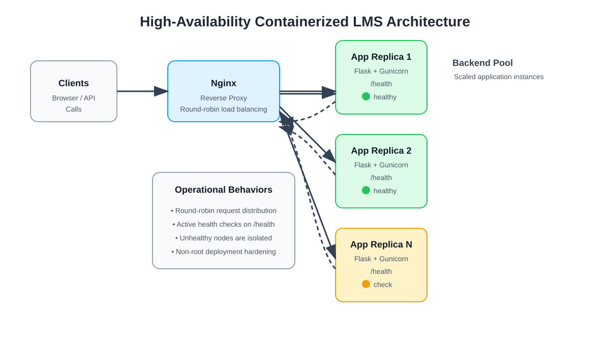

# High-Availability Containerized LMS Architecture

[](#)
[](#)
[](#)
[](#)

## Overview

This project deploys a production-ready Learning Management System (LMS) behind an Nginx reverse proxy with multiple Flask application replicas. The design focuses on resilience, health probes, and horizontal scaling so that a single application failure does not interrupt service delivery.

The architecture uses:

- Docker for containerization
- Nginx as the entry point and reverse proxy
- Flask + Gunicorn for the application runtime
- Round-robin distribution across backend replicas
- Active health checks to isolate unhealthy containers
- Non-root execution for safer container operation

---

## Architecture Diagram

The system flow is shown below:

<p align="center">
  <a href="docs/architecture.svg">
    
  </a>
</p>

---

## Key Technical Implementations

- Least-privilege security hardening with a multi-stage Docker build.
- Nginx reverse proxy with request routing and timeout handling.
- Active HTTP health checks on `/health` to detect degraded replicas.
- Containerized app deployment with Gunicorn workers.
- Load distribution to maintain availability during service updates or failures.

---

## Repository Structure

```text
containerized-lms-nginx/
├── app/
│   ├── app.py
│   └── requirements.txt
├── docs/
│   └── architecture.svg
├── nginx/
│   └── nginx.conf
├── .gitignore
├── Dockerfile
├── docker-compose.yml
├── README.md
└── LICENSE (optional)
```

---

## Prerequisites

Before starting, ensure the following tools are installed locally:

- Docker Engine 24.0+
- Docker Compose v2.0+
- A terminal with access to Docker daemon

---

## Quick Start

### 1. Clone the repository

```bash
git clone https://github.com/lax2k3/containerized-lms-nginx.git
cd containerized-lms-nginx
```

### 2. Build and start the services

```bash
docker compose up --build -d
```

If you want to start multiple app replicas:

```bash
docker compose up --scale app=2 --build -d
```

### 3. Check service status

```bash
docker compose ps
```

### 4. Validate the app

```bash
curl http://localhost/
curl http://localhost/api/courses
curl -i http://localhost/health
```

---

## Application Endpoints

### Root endpoint

```bash
curl http://localhost/
```

Returns service status, container identity, and a friendly operational message.

### Health endpoint

```bash
curl -i http://localhost/health
```

Used by Docker health checks and Nginx upstream validation.

### Courses endpoint

```bash
curl http://localhost/api/courses
```

Returns a list of sample LMS course records.

---

## Operational Notes

### Round-robin traffic distribution

Nginx routes requests across the backend application pool. Repeated calls to `/` or `/api/courses` should alternate between different container IDs when the app is scaled to multiple replicas.

### Failure handling

The reverse proxy is configured to retry failed upstream requests and skip unhealthy backend nodes after several failed attempts.

### Log inspection

```bash
docker compose logs -f app
docker compose logs -f nginx
```

---

## Troubleshooting

### HTTP 502 / 503 errors

Possible causes:

- Flask service is not running
- app container is still starting
- Nginx cannot reach the upstream server

Useful checks:

```bash
docker compose ps
docker compose logs app
curl http://localhost:5000/health
```

### Container crashes or restart loops

Check for:

- permission issues
- missing dependency installs
- memory pressure or start-up failure

```bash
docker inspect <container_id>
docker logs <container_id>
```

### Health probe failing

```bash
docker exec -it <app_container_id> curl http://localhost:5000/health
```

If the health endpoint fails, inspect the Gunicorn process and application logs before scaling or restarting the stack.

---

## Security and Reliability Features

- App runs as a non-root user inside the container
- Multi-stage build keeps the runtime image smaller and cleaner
- Health checks help detect unhealthy replicas automatically
- Nginx route configuration reduces direct backend exposure

---

## Summary

This repository demonstrates a resilient microservice pattern for an LMS application and provides a practical example of container orchestration, reverse-proxy balancing, and health-based service management.

For production deployments, you can extend this setup with:

- persistent volumes and database services
- centralized logging
- container monitoring and alerting
- managed orchestration platforms such as Docker Swarm or Kubernetes

---

## License

This project is distributed under the MIT License.
